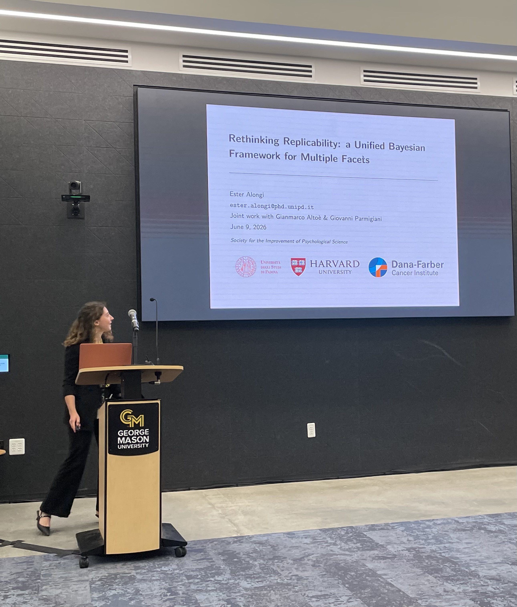
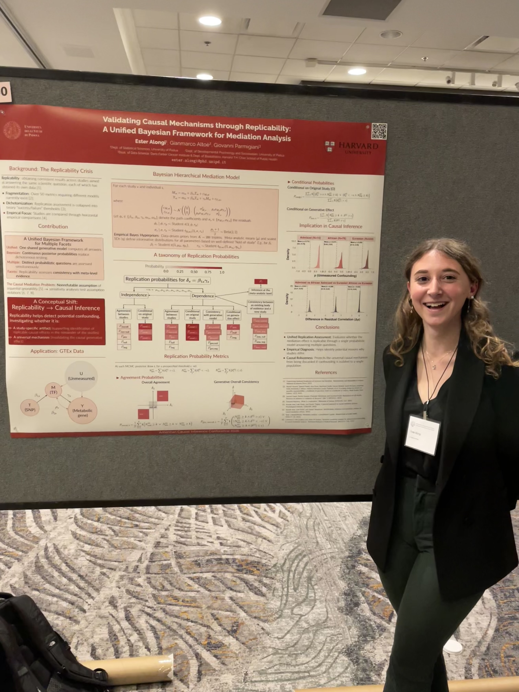

## Talks and Presentations {.central}

[2026]{.blue}

**AIP -- Experimental Section XXXII Conference**, Venice, Italy, September — *Toward Robust Replicability: Modern Perspectives and Methods* — [Symposium]{.ggreen}

Accepted symposium presentation. Organizer: M. Calderan.  
Speakers: E. Alongi, S. Garofalo, M. Calderan, A. Andreella.  
Moderator: M. O. Epifania.

**JSM 2026**, Boston, MA, August — *Multi-Study Mediation Analysis* — [Contributed talk]{.gyellow}

---

:::::: {layout="[35, 65]"}
::: {}

:::
::: {}
**SIPS 2026**, Washington D.C., June — *Rethinking Replicability: a Unified Bayesian Framework for Multiple Facets* — [Contributed talk]{.gyellow}
:::
::::::

---

:::::: {layout="[65, 35]"}
::: {}
**ACIC 2026**, Salt Lake City, UT, May — *Validating Causal Mechanisms through Replicability: A Unified Bayesian Framework for Mediation Analysis* — [Poster]{.ggreen}
:::
::: {}

:::
::::::

---

**Psicostat**, Padova, Italy, April — *Rethinking Replicability: a Unified Bayesian Framework for Multiple Facets* — [Contributed talk]{.gyellow}

---

[2025]{.blue}

**SIS 2025**, Genova, Italy, June — *Surveillance of fraudulent activities through dynamic networks* — [Contributed talk]{.gyellow}